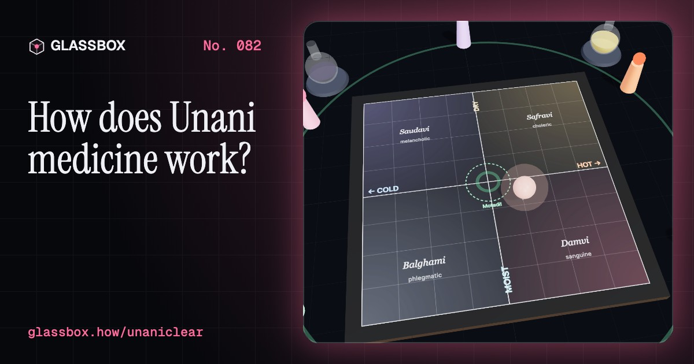
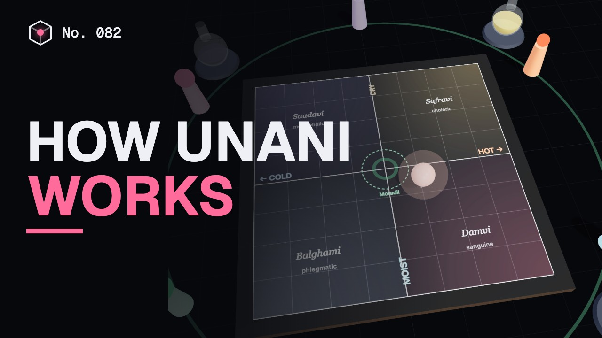
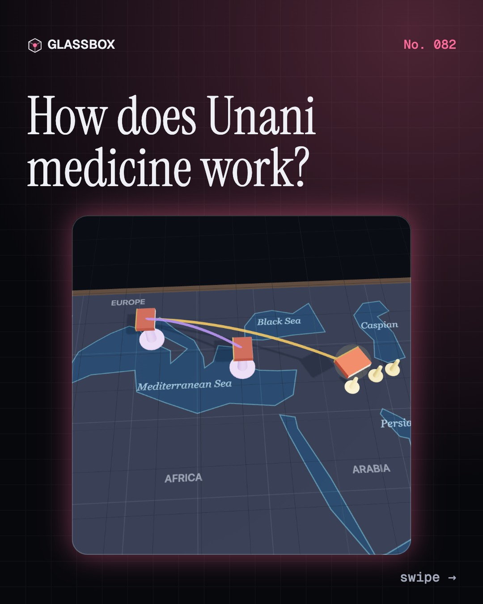
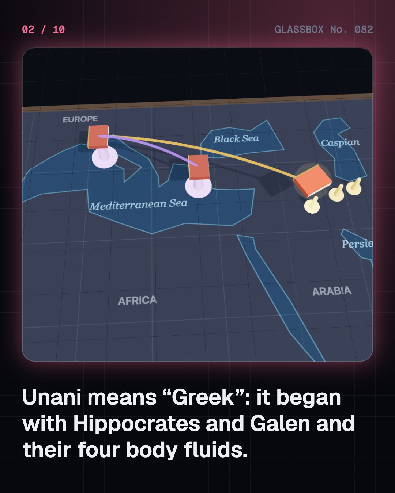
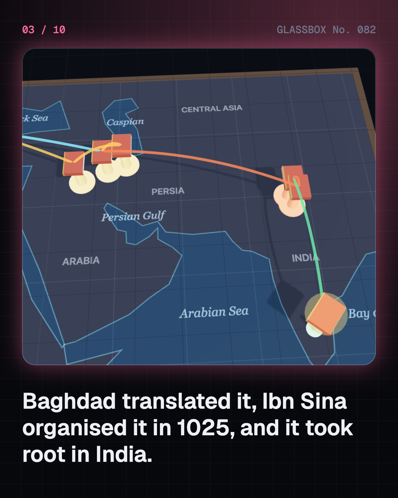
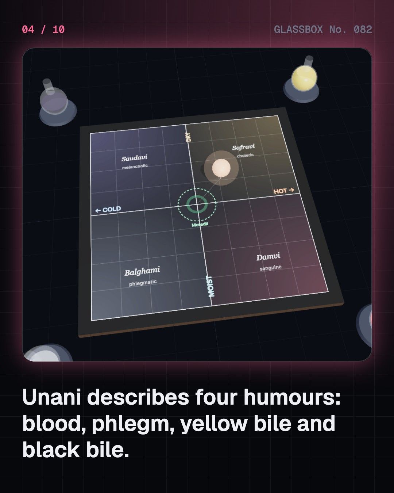

<!-- glassbox:start -->
<!-- Generated from glassbox.json by the Glassbox hub (npm run readme -- unaniclear). Edit glassbox.json, not this block. -->
<p align="center"><a href="https://glassbox-production-fd52.up.railway.app/e/unaniclear/"></a></p>

<h1 align="center">UnaniClear</h1>

<p align="center"><b>How does Unani medicine work?</b><br>Unani means “Greek”: a 2,400-year-old system that travelled from Hippocrates to Baghdad to Delhi. Follow Ibn Sina’s Canon across a map, move a patient’s mizaj across the hot–cold, moist–dry board, work out the suction in a hijama cup, and run a fair trial to see what the evidence really says.</p>

<p align="center"><a href="https://glassbox-production-fd52.up.railway.app/unaniclear/"><b>▶ Play with it</b></a> &nbsp;·&nbsp; <a href="https://glassbox-production-fd52.up.railway.app/e/unaniclear/">Read the 60-second explainer</a> &nbsp;·&nbsp; <a href="https://glassbox-production-fd52.up.railway.app/unaniclear/glassbox/reel.mp4">Watch the 40-second video</a></p>

<p align="center">
  <a href="https://glassbox-production-fd52.up.railway.app/e/unaniclear/"></a>
  <a href="https://glassbox-production-fd52.up.railway.app/e/unaniclear/"></a>
  <a href="LICENSE"></a>
  <a href="LICENSE-CONTENT.md"></a>
  <a href="#privacy"></a>
</p>

## In 60 seconds

1. **From Greece to Baghdad to Delhi.** Unani grew from the Greek medicine of Hippocrates and Galen. Baghdad’s translators put it into Arabic, al-Razi and Ibn Sina expanded it, and hakims brought it to India from the 13th century. Today India has more Unani colleges, hospitals and practitioners than anywhere else, under the Ministry of AYUSH.
2. **Four humours, one temperament.** In its own terms, Unani says the body holds four humours, dam, balgham, safra and sauda, whose mix sets your mizaj: hot or cold, moist or dry. Tabiyat, the body’s healing power, keeps pulling it back to balance, and six essential factors such as air, food and sleep tip it.
3. **Pulse, flask, cup and jar.** A hakim reads the pulse (nabz), looks at urine in a flask (qaroora) and asks about your life. Treatments are regimental therapy such as hijama (cupping), diet, and medicines like majoon, khamira and arq. In fire cupping, air sealed at 120 °C cools to skin temperature and its pressure falls by about 22 kPa.
4. **What history got right and wrong.** Ibn Sina’s Canon set out rules for testing a medicine and described diseases that pass between people. But the theory of humours did not survive: cells, germs and chemistry replaced it in the 1800s. The popular story that Ibn Sina invented a 40-day quarantine is not in the Canon.
5. **What the evidence says.** Only a fair test, randomised, blinded and placebo-controlled, can show if a remedy works. Good trials of Unani medicines are still few, and cupping trials are mostly low quality. Some preparations have contained lead or mercury, and herbs can interact with medicines.
6. **Using it wisely.** Never stop prescribed medicine, tell every doctor and hakim what you take, and see a qualified doctor for serious illness. Unani’s six factors overlap with evidence-based advice, like ICMR-NIN’s limit of 5 g of added salt a day and 30–45 minutes of activity.

## Words worth knowing

| Term | Meaning |
|---|---|
| **Unani** | From “Yunani”, Greek: a system of medicine built on Greek humoral theory, developed in the Islamic world and now practised mainly in South Asia. |
| **Hakim** | A practitioner of Unani medicine; in India, trained through the 5½-year BUMS degree. |
| **Akhlat (humours)** | Unani’s four body fluids: dam (blood), balgham (phlegm), safra (yellow bile) and sauda (black bile). |
| **Mizaj** | Temperament: a person’s blend of hot or cold and moist or dry, as Unani describes it. |
| **Tabiyat** | In Unani, the body’s own power to keep itself in balance and heal. |
| **Asbab-e-sitta zarooriya** | The six essential factors: air, food and drink, movement and rest, emotions, sleep and waking, retention and elimination. |
| **Hijama** | Cupping: a cup with low pressure inside sucks up the skin; wet cupping also draws a little blood. |
| **Placebo** | A look-alike dummy treatment; comparing against it shows what a remedy really adds. |
| **AYUSH** | India’s ministry for Ayurveda, Yoga, Unani, Siddha, Sowa-Rigpa and Homoeopathy, set up in 2014; CCRUM is its Unani research council. |

## A short history

**From Hippocrates to Baghdad to Delhi: 2,400 years of the “Greek medicine”.**

- **400 BCE** · Four humours in the body (Hippocrates and his followers (the treatise is often credited to his son-in-law Polybus), Kos)
- **170** · Galen builds the system (Galen of Pergamon, Pergamon and Rome)
- **830** · The House of Wisdom translates the Greeks (Scholars of the Abbasid caliphs, especially under al-Ma’mun (r. 813–833), Baghdad)
- **900** · A doctor who kept notes (Abu Bakr al-Razi (Rhazes), Rey and Baghdad)
- **1025** · The Canon of Medicine (Ibn Sina (Avicenna), Hamadan)
- **1206** · Hakims come to India (Physicians of the Delhi Sultanate, Delhi)
- **1650** · Still a textbook in Europe (Medical schools of Montpellier and Louvain, Montpellier and Louvain)
- **1858** · Europe drops the humours (Rudolf Virchow, then Louis Pasteur and Robert Koch, Berlin and Paris)

The full story, with 30 moments, charts, people and 38 sources: [glassbox.how/e/unaniclear/history](https://glassbox-production-fd52.up.railway.app/e/unaniclear/history/). The data lives in [`history.json`](history.json).

## Video and slides

Made with the Glassbox studio from this box's storyboard (`window.glassbox.director`). Free to reuse under CC BY 4.0.

<a href="https://glassbox-production-fd52.up.railway.app/unaniclear/glassbox/video.mp4"></a>

<p><a href="glassbox/slide-1.jpg"></a> <a href="glassbox/slide-2.jpg"></a> <a href="glassbox/slide-3.jpg"></a> <a href="glassbox/slide-4.jpg"></a></p>

| File | What | Size |
|---|---|---|
| [`glassbox/reel.mp4`](https://glassbox-production-fd52.up.railway.app/unaniclear/glassbox/reel.mp4) | Reel / Short, with captions and soundtrack | 1080×1920 |
| [`glassbox/video.mp4`](https://glassbox-production-fd52.up.railway.app/unaniclear/glassbox/video.mp4) | YouTube video, with captions and soundtrack | 1920×1080 |
| `glassbox/slide-1…10.jpg` | Instagram carousel | 1080×1350 |
| `glassbox/thumb.jpg` | YouTube thumbnail | 1280×720 |
| `glassbox/cover.jpg` | Share card and repo social preview | 1200×630 |
| [`glassbox/history-reel.mp4`](https://glassbox-production-fd52.up.railway.app/unaniclear/glassbox/history-reel.mp4) | “History in 10 moments” Reel / Short | 1080×1920 |
| `glassbox/history-slide-*.jpg` | History carousel | 1080×1350 |
| `glassbox/post.json` | Post copy and schedule used by the publish kit | |

## Privacy

This box has no accounts and no ads, and it ships its own fonts and libraries. When you run it yourself it sends nothing anywhere. On glassbox.how, the site's `/bar.js` also loads Glassbox's analytics: **Google Analytics** to count visits (it asks first in the EU, UK and Switzerland, and stays off when your browser sends Global Privacy Control or Do Not Track) and **ClickTrust** to detect bots.

It remembers a few things **in your own browser only**, and never sends them anywhere:

| Browser storage key | What it holds |
|---|---|
| `unaniclear.v1` | Which chapters you have opened, your best quiz scores, and sound on or off. |

Exactly what each one sees is at [glassbox.how/privacy](https://glassbox-production-fd52.up.railway.app/privacy/).

## Licences

- **Code:** [MIT](LICENSE). Use it, change it, ship it.
- **Explanations, text, images and videos** (`glassbox.json`, `glassbox/`): [CC BY 4.0](LICENSE-CONTENT.md). Credit “Glassbox, glassbox.how/e/unaniclear”.
- **Third-party parts** keep their own licences: [three.js](https://threejs.org) (MIT), [Geist, Instrument Serif](https://openfontlicense.org) (SIL OFL 1.1).
- The Glassbox name and logo aren't covered by either licence. See the [terms](https://glassbox-production-fd52.up.railway.app/terms/).

Found a mistake? [Open an issue](https://github.com/bdeeps/unaniclear/issues). Corrections happen in public.
<!-- glassbox:end -->

## Run it

It's plain HTML, CSS and JavaScript. No build step and no dependencies. Run locally, it contacts no other website.

```bash
python3 -m http.server 8000
```

Three.js and the fonts ship in `vendor/` and `fonts/`, so it also works offline.

Then open http://localhost:8000.

## How it's built

| File | What |
|---|---|
| `index.html`, `css/app.css` | The page and its styles |
| `js/app.js`, `js/stage.js`, `js/ui.js`, `js/kit.js` | The shared Glassbox 3D engine: chapters, 3D stage, controls, quiz, video director |
| `js/unani.js` | Shared models and helpers: the four humours and the mizaj sketch (as Unani describes them), the six essential factors, a stylised person, books, flasks and jars, a seeded random generator, labels and boards |
| `js/chapters/*.js` | One file per chapter: the 3D model, controls, text, key terms, quiz and video scenes |
| `glassbox.json` | Title, question, explainer beats, key terms, browser storage and credits shown on glassbox.how |
| `reel` in each chapter | The storyboard the Glassbox studio records into short videos |
| `glassbox/` | The published video, slides, thumbnail and post copy |
| `fonts/`, `vendor/three/` | Self-hosted Geist and Instrument Serif (SIL OFL 1.1) and three.js (MIT) |
